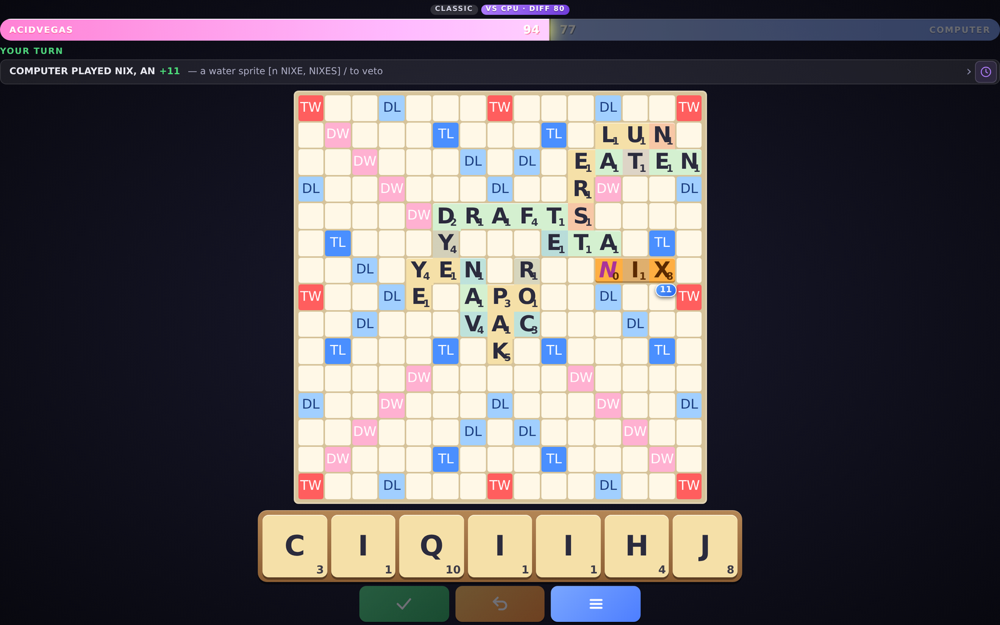
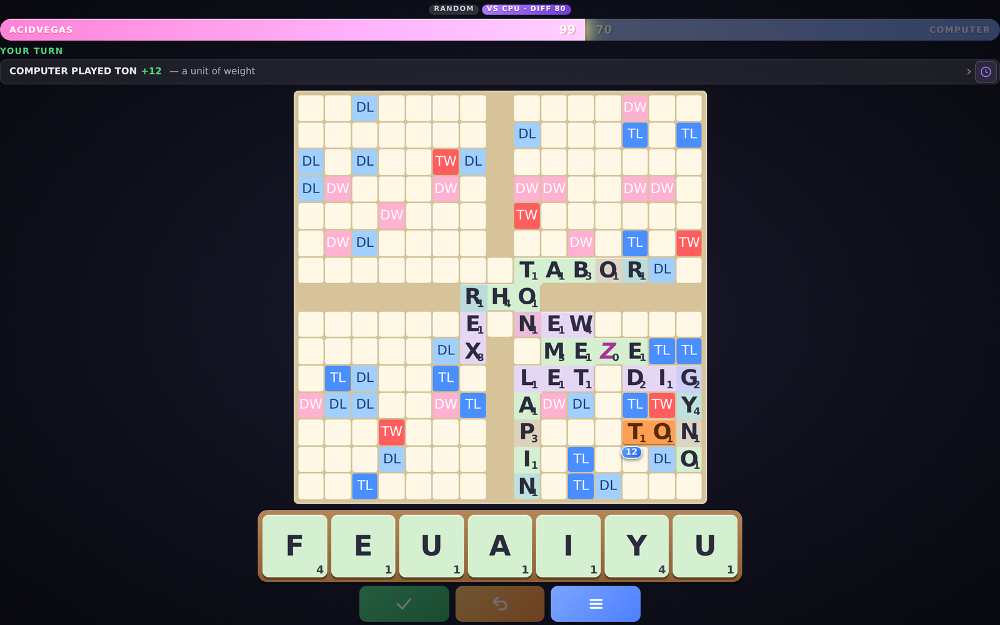
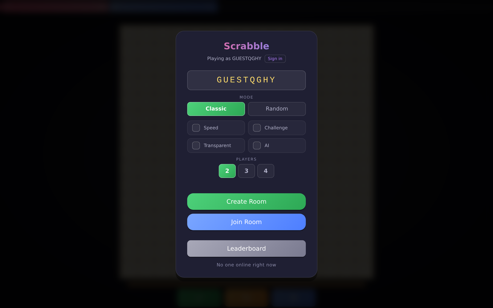
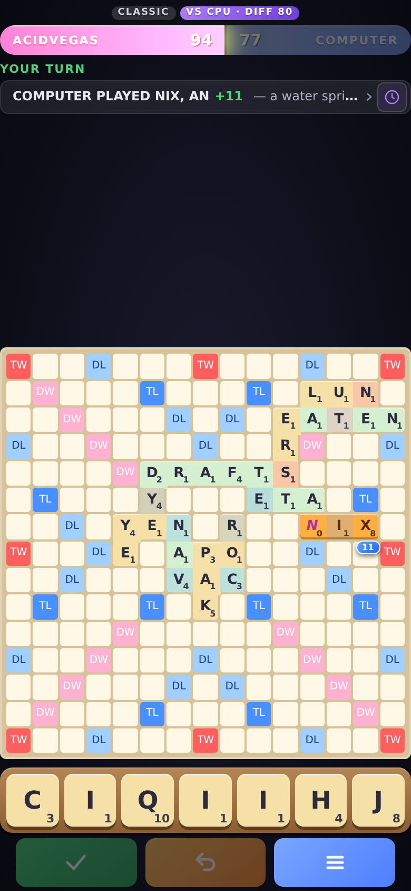

<h1 align="center">
  
</h1>

<p align="center"><b>Multiplayer Scrabble in the browser, built with Flask.</b></p>

<p align="center">
  <a href="https://scrabble.supernets.org"></a>
</p>

<p align="center">
  
  
  
  
  <a href="LICENSE"></a>
</p>

<p align="center">
  
</p>

Players create a room and share its 4-character code. Words are checked against the NWL2023 word list, and each play shows the definitions of the words it formed.

## Screenshots

<table>
  <tr>
    <td width="50%"></td>
    <td width="50%"></td>
  </tr>
  <tr>
    <td align="center"><i>Random mode, with shuffled bonus squares and blocked cells</i></td>
    <td align="center"><i>Room setup</i></td>
  </tr>
</table>

<p align="center">
  <br>
  <i>Playing on a phone</i>
</p>

## Features

- 2 to 4 players per room, plus spectators *(open `/<room>?watch=true`)*
- **Classic** mode uses the standard board. **Random** mode shuffles the bonus squares, blocks some cells, and can add extra star squares or zero-value letter squares.
- Optional room rules:

| Rule        | What it does                                                                                           |
|-------------|--------------------------------------------------------------------------------------------------------|
| Speed       | 60 seconds per turn, 5 turns each, and 3 missed turns in a row forfeits the game                       |
| Challenge   | Any word can be played. The next player can challenge, and invalid plays are taken back                |
| Transparent | Other players can see the tiles you are placing before you submit                                      |
| AI          | Play against the computer at difficulty 1-100, or as "Stacker", which goes for the most words per play |

- Optional accounts *(username, password and a captcha)* track wins, streaks, best plays and most-played words
- Failed logins are limited per account and per IP, and the captcha is drawn as paths so its answer is not in the markup
- Signed-in players earn a hint token for every 5 wins, up to 5 tokens
- Signed-in players level up by finishing games against the computer and unlock 113 tile styles, each with its own challenge *(difficulty, streaks, modes, big plays, comebacks and more)*
- Per-room chat, move history, an unseen-tile tracker and rematches
- Global leaderboard for classic and random games
- Live updates over Server-Sent Events, with polling as a fallback

## Requirements

- Python 3.12+
- [Flask](https://pypi.org/project/Flask/)
- [gunicorn](https://pypi.org/project/gunicorn/) with the [gevent](https://pypi.org/project/gevent/) worker

## Running locally

```bash
pip install -r requirements.txt
cd scrabble
gunicorn --worker-class gevent --workers 1 --bind 0.0.0.0:1337 app:app
```

Game state lives in memory, so always run a single worker. `python3 app.py` also works for development, using Flask's built-in server.

The server listens on port `1337`. If `scrabble/words/nwl2023.txt` is missing, it is downloaded from the [scrabblewords](https://github.com/scrabblewords/scrabblewords) repository on startup.

## Running with Docker

```bash
./setup.sh
```

This builds the `scrabble` image and starts a container named `scrabble`, bound to `127.0.0.1:1337` with the `scrabble_data` volume mounted at `/data`. Put a reverse proxy in front of it to serve it publicly.

If the game is reachable on more than one domain, set `SCRABBLE_PUBLIC_URL` *(e.g. `https://scrabble.acid.vegas`)* to the main one. The canonical link, share cards, robots.txt and sitemap then point there instead of at whichever host the request used. `setup.sh` passes it to the container when it is set.

## Code layout

Everything the server runs lives in `scrabble/`:

| Path          | Contents                                                                    |
|---------------|-----------------------------------------------------------------------------|
| `app.py`      | Flask app, room state, live updates and all routes                          |
| `game.py`     | Game rules: new games, placement checks, turns, speed timer, computer turns |
| `move_gen.py` | Move finder, scoring and word extraction                                    |
| `boards.py`   | Classic board and the random board generator                                |
| `storage.py`  | SQLite storage for rooms and stats, daily backups                           |
| `auth.py`     | Accounts, sessions and captcha                                              |
| `words.py`    | Word list loading and definitions                                           |
| `static/`     | `script.js` and `style.css`                                                 |
| `templates/`  | `index.html`                                                                |
| `words/`      | The NWL2023 word list                                                       |

## Data

All data is written to the directory in `SCRABBLE_DATA_DIR`. It defaults to `data/` at the repo root, and the Docker image sets it to `/data`.

| File           | Contents                                              |
|----------------|-------------------------------------------------------|
| `metrics.db`   | Accounts, sessions, player stats and leaderboard data |
| `rooms.sqlite` | Active rooms, so games survive a restart              |
| `backups/`     | Daily copies of both databases, kept for 7 days       |

Rooms with no activity for 24 hours are removed. The server holds at most 100 rooms at a time. One IP address can have at most 5 unfinished rooms and 20 open event streams at once.

## acid-arcade-db

Scrabble can optionally use [acid-arcade-db](https://github.com/acidvegas/acid-arcade-db) for accounts, so one username and password works on every acid-arcade game. Without `ARCADE_URL` it keeps its own accounts and needs nothing else.

| Variable            | Purpose                                                                                                                                                                                                                                    |
|---------------------|--------------------------------------------------------------------------------------------------------------------------------------------------------------------------------------------------------------------------------------------|
| `ARCADE_URL`        | Internal acid-arcade-db API *(e.g. `http://acid-arcade-db:20021`)*. Turns the mode on                                                                                                                                                      |
| `ARCADE_PUBLIC_URL` | Public acid-arcade-db site, used for profile pictures and the account settings link. `{domain}` is replaced with the player's parent domain *(default `https://arcade.{domain}`, so scrabble.supernets.org links to arcade.supernets.org)* |
| `ARCADE_GAME`       | This game's slug in acid-arcade-db, `scrabble`                                                                                                                                                                                             |
| `ARCADE_KEY`        | This game's key, needed when acid-arcade-db has `ARCADE_GAME_KEYS` set                                                                                                                                                                     |

In this mode login, signup and sessions go through acid-arcade-db, and the local `users` table only mirrors those accounts. Renames and account deletions are picked up every 60 seconds, and each player's wins and stats are sent to their arcade profile when a game ends. If acid-arcade-db is down, account requests answer `503`. Running `ARCADE_URL=http://acid-arcade-db:20021 ./setup.sh` joins the container to the `arcade` Docker network and passes these variables.

A finished game between one signed in player and the computer *(2-seat rooms only)* is reported to acid-arcade-db as an `ai_game` *(result, difficulty, style, the player's turns and both scores)*, which pays casino chips for wins. Rooms with more seats are never reported, so other seats can't feed the player. Games abandoned for a day are not reported, a forfeit only ever reports the player's own loss, and challenge mode *(the only undo)* is off against the computer.

## Tests

```bash
python3 -m unittest discover -s tests
```

Run it from the repo root. The tests use a throwaway data directory that is removed when they finish.

---

###### Mirrors: [SuperNETs](https://git.supernets.org/acidvegas/) • [GitHub](https://github.com/acidvegas/) • [GitLab](https://gitlab.com/acidvegas/) • [Codeberg](https://codeberg.org/acidvegas/)
